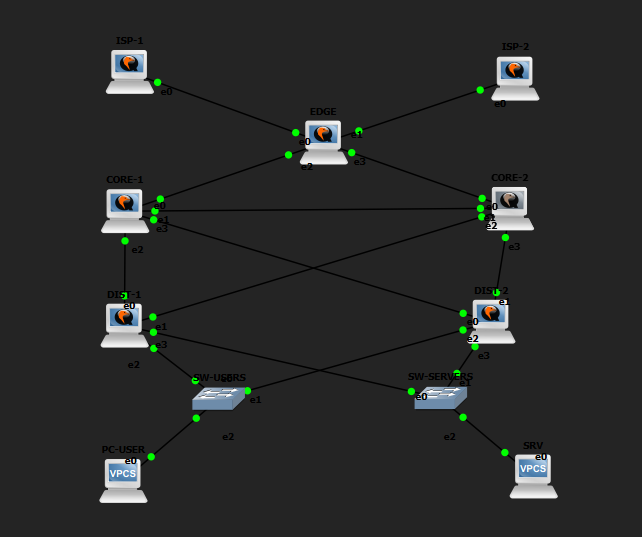
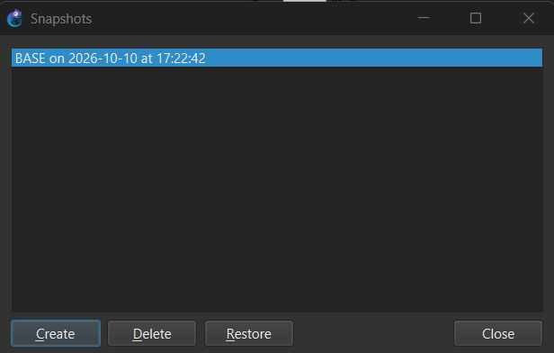
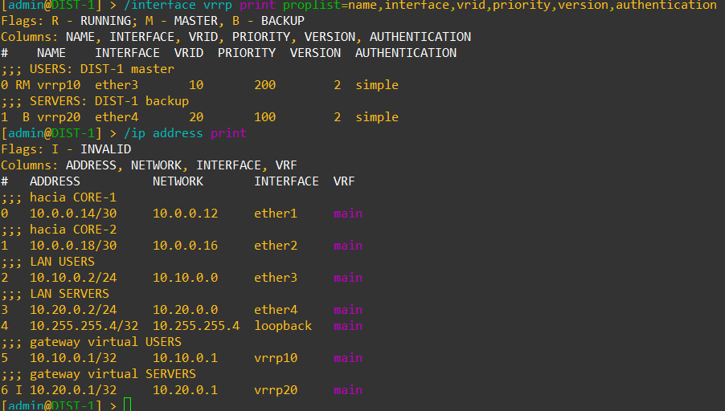
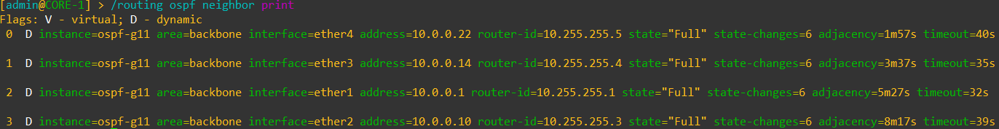
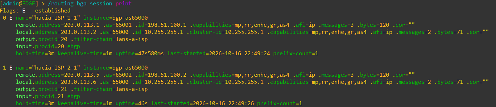

# Memoria del Laboratorio — Failover Routing

**Grupo:** 11
**Materia:** Gestión Operativa y Seguridad en Redes (GOYS) — UTN FR La Plata
**Fecha de entrega:** viernes 23/10/2026

## Integrantes y roles

> Grupo de 4 integrantes: los roles R2 y R3 los cubre la misma persona.

| Integrante | Rol |
|-----------|-----|
| Santiago Natalichio Bestosini | R1 — Líder / Edge-WAN |
| Tomás Martin | R2 — Proveedores |
| Tomás Martin | R3 — Core |
| Juan Bautista Cuenca | R4 — Distribución |
| Lautaro Aubert | R5 — Hosts / QA / Operación |

---

## 1. Diseño (F0)

### 1.1 Corrección del diagrama

Partimos del diagrama "Enterprise Network Design (Cisco)" que vimos en clase y de los defectos que le encontramos (`analisis.md`). Estos son los que corregimos en nuestro diseño:

| # | Defecto detectado | Corrección aplicada | Justificación |
|:-:|-------------------|---------------------|---------------|
| 1 | Hay un solo firewall. Si se rompe, toda la empresa se queda sin Internet, aunque tenga dos proveedores. | En el lab no armamos un firewall aparte (las reglas de filtrado van en el router EDGE). Dejamos documentado que en una red real tienen que ir dos firewalls, uno activo y otro de respaldo. | De nada sirve tener dos ISPs si todo el tráfico pasa por un único equipo que puede fallar. Lo que está en el camino crítico tiene que estar duplicado. |
| 2 | Hay redes repetidas: la misma dirección (192.168.10.0/24) aparece en dos sitios distintos. | Armamos un plan de direcciones donde cada enlace y cada red tiene un rango propio que no se repite (sección 1.2). | Si dos redes tienen la misma dirección, los routers no pueden distinguirlas y una de las dos queda inalcanzable. Por eso el plan de IPs se define antes de configurar nada. |
| 3 | Los dos routers del core (CORE-1 y CORE-2) no están conectados entre sí. | Agregamos el cable CORE-1 ↔ CORE-2. | Si se corta el enlace entre el EDGE y CORE-1, CORE-1 queda sin salida. Con el cable core–core puede seguir mandando el tráfico por CORE-2. Es lo que hace que OSPF pueda recalcular la ruta en el drill 2. |
| 4 | La puerta de enlace de las PCs (HSRP) está en el core, que debería ser solo un "pasillo" de tránsito. Además HSRP es propietario de Cisco. | Movemos la puerta de enlace redundante a los routers de distribución (DIST-1 y DIST-2) y usamos VRRP, que es el estándar abierto. El core queda solo con OSPF. | En una red jerárquica cada capa hace una cosa: distribución es la puerta de enlace de las PCs, el core solo mueve tráfico rápido. Mezclar las dos cosas complica el core. Y usamos VRRP porque funciona con cualquier marca (nuestros routers son MikroTik, no Cisco). |
| 5 | El diagrama pone un Route Reflector de iBGP cruzando el firewall, algo que no corresponde y que a esta escala no hace falta. | El router EDGE habla eBGP directamente con los dos ISPs. Sin Route Reflector. | Un Route Reflector sirve cuando hay muchos routers BGP internos. Nosotros tenemos uno solo (el EDGE), así que agregarlo es sumar algo que puede fallar sin ningún beneficio. |

Otros problemas que tiene el diagrama y que quedan fuera del alcance del lab (voz sin QoS, falta de VLAN de gestión y de protecciones en los switches): los dejamos anotados pero no los implementamos.

### 1.2 Plan de direccionamiento (IPAM)

**Convención general:**

| Bloque | Uso | Regla |
|--------|-----|-------|
| `10.0.0.0/24` | Enlaces punto a punto internos (EDGE/CORE/DIST) | Un **/30** por enlace, asignados de a 4 (`.0`, `.4`, `.8`, …). Extremo "superior" en la jerarquía toma la IP impar menor. |
| `10.10.0.0/24` | LAN **USERS** | Gateway virtual VRRP `.1`, DIST-1 `.2`, DIST-2 `.3`, hosts desde `.100` |
| `10.20.0.0/24` | LAN **SERVERS** | Gateway virtual VRRP `.1`, DIST-1 `.2`, DIST-2 `.3`, hosts desde `.100` |
| `10.255.255.0/24` | Loopbacks internos = **router-id** OSPF/BGP | Un **/32** por router |
| `203.0.113.0/24` | Enlaces EDGE ↔ ISP (simula direccionamiento público) | Un **/30** por ISP |
| `198.51.100.0/24` | Loopbacks de los ISP (simulan "Internet") | Un **/32** por ISP; es el destino que deben alcanzar los hosts |

> `203.0.113.0/24` y `198.51.100.0/24` son rangos reservados para documentación (RFC 5737): nunca colisionan con Internet real ni con redes privadas.

**Tabla de enlaces y LANs (15 enlaces, 11 nodos):**

| # | Enlace / Red | Subred | Dispositivo A (IP / iface) | Dispositivo B (IP / iface) |
|:-:|--------------|:------:|----------------------------|----------------------------|
| 1 | ISP-1 ↔ EDGE | `203.0.113.0/30` | ISP-1 `203.0.113.1/30` ether1 | EDGE `203.0.113.2/30` ether1 |
| 2 | ISP-2 ↔ EDGE | `203.0.113.4/30` | ISP-2 `203.0.113.5/30` ether1 | EDGE `203.0.113.6/30` ether2 |
| 3 | EDGE ↔ CORE-1 | `10.0.0.0/30` | EDGE `10.0.0.1/30` ether3 | CORE-1 `10.0.0.2/30` ether1 |
| 4 | EDGE ↔ CORE-2 | `10.0.0.4/30` | EDGE `10.0.0.5/30` ether4 | CORE-2 `10.0.0.6/30` ether1 |
| 5 | CORE-1 ↔ CORE-2 (core–core) | `10.0.0.8/30` | CORE-1 `10.0.0.9/30` ether2 | CORE-2 `10.0.0.10/30` ether2 |
| 6 | CORE-1 ↔ DIST-1 | `10.0.0.12/30` | CORE-1 `10.0.0.13/30` ether3 | DIST-1 `10.0.0.14/30` ether1 |
| 7 | CORE-2 ↔ DIST-1 | `10.0.0.16/30` | CORE-2 `10.0.0.17/30` ether3 | DIST-1 `10.0.0.18/30` ether2 |
| 8 | CORE-1 ↔ DIST-2 | `10.0.0.20/30` | CORE-1 `10.0.0.21/30` ether4 | DIST-2 `10.0.0.22/30` ether1 |
| 9 | CORE-2 ↔ DIST-2 | `10.0.0.24/30` | CORE-2 `10.0.0.25/30` ether4 | DIST-2 `10.0.0.26/30` ether2 |
| 10 | DIST-1 ↔ SW-USERS | `10.10.0.0/24` | DIST-1 `10.10.0.2/24` ether3 | SW-USERS (L2, sin IP) |
| 11 | DIST-2 ↔ SW-USERS | `10.10.0.0/24` | DIST-2 `10.10.0.3/24` ether3 | SW-USERS (L2, sin IP) |
| 12 | DIST-1 ↔ SW-SERVERS | `10.20.0.0/24` | DIST-1 `10.20.0.2/24` ether4 | SW-SERVERS (L2, sin IP) |
| 13 | DIST-2 ↔ SW-SERVERS | `10.20.0.0/24` | DIST-2 `10.20.0.3/24` ether4 | SW-SERVERS (L2, sin IP) |
| 14 | SW-USERS ↔ PC-USER | `10.10.0.0/24` | SW-USERS (L2) | PC-USER `10.10.0.100/24` gw `10.10.0.1` |
| 15 | SW-SERVERS ↔ SRV | `10.20.0.0/24` | SW-SERVERS (L2) | SRV `10.20.0.100/24` gw `10.20.0.1` |

> Los enlaces 10–13 comparten la misma LAN (/24) porque los dos DIST son miembros del mismo dominio de broadcast a través del switch; **no es solapamiento**, es la misma red vista desde dos routers (requisito de VRRP). La numeración de interfaces (`etherN`) se verificará contra el proyecto GNS3 provisto en F1 y se corregirá en esta tabla si difiere, vía change log.

**VRRP (load-sharing entre grupos):**

| Grupo | VRID | Master | Backup | Priority (master / backup) | IP virtual | Auth |
|-------|:----:|:------:|:------:|:--------------------------:|:----------:|------|
| USERS (`10.10.0.0/24`) | **10** | DIST-1 | DIST-2 | 200 / 100 | `10.10.0.1/32` | simple, ver 1.3 |
| SERVERS (`10.20.0.0/24`) | **20** | DIST-2 | DIST-1 | 200 / 100 | `10.20.0.1/32` | simple, ver 1.3 |

> Con DIST-1 master del grupo 10 y DIST-2 master del grupo 20, **ambos routers trabajan en simultáneo** (drill 5) y cada uno respalda al otro (drill 1).

**Loopbacks / Router-IDs:**

| Nodo | AS | Loopback (= router-id OSPF y BGP) |
|------|:--:|:---------------------------------:|
| ISP-1 | 65001 | `198.51.100.1/32` |
| ISP-2 | 65002 | `198.51.100.2/32` |
| EDGE | 65000 | `10.255.255.1/32` |
| CORE-1 | — (OSPF) | `10.255.255.2/32` |
| CORE-2 | — (OSPF) | `10.255.255.3/32` |
| DIST-1 | — (OSPF) | `10.255.255.4/32` |
| DIST-2 | — (OSPF) | `10.255.255.5/32` |

**Protocolos por enlace:**

| Enlace | Protocolo |
|--------|-----------|
| ISP-1 ↔ EDGE, ISP-2 ↔ EDGE | eBGP (TCP-MD5). Los ISP anuncian default-route (`default-originate`) y su propio loopback /32 (agregado en F3, ver 4.1); el EDGE anuncia 10.10.0.0/24 y 10.20.0.0/24 (redistribuidas desde OSPF). |
| EDGE ↔ CORE-x, CORE-1 ↔ CORE-2, CORE-x ↔ DIST-x | OSPF área 0, autenticación MD5. El EDGE inyecta la default en OSPF. |
| LAN USERS / SERVERS | VRRP con autenticación. Interfaces pasivas en OSPF (se anuncia la red pero no se forman vecinos hacia los hosts). |

**Verificación de no solapamiento:** 9 enlaces /30 (7 dentro de `10.0.0.0/24` ocupando `.0`–`.27`, 2 en `203.0.113.0/24`), 2 LANs /24 distintas, 7 loopbacks /32 distintos en dos bloques separados. Ningún prefijo contiene a otro.

### 1.3 Política de seguridad

**Usuarios y privilegios (idéntico en los 7 routers):**

| Usuario | Grupo RouterOS | Permisos | Uso |
|---------|----------------|----------|-----|
| `admin` | `full` | Lectura, escritura, reboot, políticas | Único usuario con permiso de cambio. Contraseña fuerte (≥ 14 caracteres, mayúsculas, minúsculas, números y símbolos), distinta de la de fábrica (CHR viene sin password). |
| `monitor` | `read` | Solo lectura | Usado para verificaciones, drills y monitoreo. **No puede modificar nada**. Es el usuario con el que R5 ejecuta los chequeos. |

- Se elimina cualquier otro usuario por defecto. No se crean usuarios personales adicionales: la trazabilidad de **quién** cambió **qué** se obtiene del change log + los commits de git firmados por cada rol, no de usuarios locales.
- Login remoto solo con `admin` para cambios aprobados en el change log, y con `monitor` para todo lo demás.

**Servicios que se deshabilitan (`/ip service`):**

| Servicio | Estado | Motivo |
|----------|:------:|--------|
| `telnet` | **disabled** | Texto plano, credenciales visibles en la red |
| `ftp` | **disabled** | Texto plano; los backups se extraen por SSH/SCP |
| `www` (HTTP) | **disabled** | Texto plano |
| `api`, `api-ssl` | **disabled** | No se usa automatización por API en este lab |
| `www-ssl` | **disabled** | No se usa WebFig |
| `ssh` (22) | habilitado | Gestión por CLI. Restringido con `address=` a las redes de gestión (loopbacks `10.255.255.0/24` y LAN SERVERS `10.20.0.0/24`). |
| `winbox` (8291) | habilitado | Gestión GUI. Misma restricción de `address=`. |

Además: `/tool mac-server set allowed-interface-list=none`, `/tool mac-server mac-winbox set allowed-interface-list=none`, `/ip neighbor discovery-settings set discover-interface-list=none` en las interfaces hacia los ISP, `/tool bandwidth-server set enabled=no`, y `/ip dns` sin `allow-remote-requests`.

**Cliente DHCP de fábrica (agregado en F1):** el CHR trae de fábrica un cliente DHCP en `ether1` con `add-default-route=yes`. Se elimina en los 7 routers con `/ip dhcp-client remove [find]`: el diseño usa solo direcciones estáticas, y ese cliente aceptaría una dirección y una ruta por defecto de cualquier servidor DHCP que le respondiera (en el EDGE, `ether1` es el enlace hacia ISP-1). Como `/system reset-configuration` lo vuelve a crear, también se quita después de cada restore (ver 6.2).

**Claves de autenticación del plano de control:**

| Protocolo | Mecanismo | Clave | Dónde |
|-----------|-----------|-------|-------|
| OSPF | MD5, key-id 1 | `<CLAVE_OSPF>` | Todas las interfaces OSPF activas (EDGE↔CORE, CORE↔CORE, CORE↔DIST) |
| BGP (ISP-1) | TCP-MD5 | `<CLAVE_BGP_ISP1>` | Sesión EDGE ↔ ISP-1, configurada en ambos extremos |
| BGP (ISP-2) | TCP-MD5 | `<CLAVE_BGP_ISP2>` | Sesión EDGE ↔ ISP-2, configurada en ambos extremos |
| VRRP grupo 10 | simple (máx. 8 caracteres en RouterOS) | `<CLAVE_VRRP_10>` | DIST-1 y DIST-2, interfaz hacia USERS |
| VRRP grupo 20 | simple | `<CLAVE_VRRP_20>` | DIST-1 y DIST-2, interfaz hacia SERVERS |

- Claves **distintas por protocolo y por sesión BGP**, para que comprometer una no comprometa las otras.
- La prueba obligatoria de F4 (adyacencia/sesión con clave incorrecta **debe fallar**) se ejecuta cambiando una sola de estas claves en un extremo.

**Gestión de secretos (dónde viven las claves reales):**

- Las claves reales (`admin`, `monitor`, OSPF, BGP y VRRP) **no se escriben en el repo**: ni en esta memoria, ni en los `.rsc`, ni en los mensajes de commit. En su lugar se usan los marcadores de la tabla anterior (`<CLAVE_OSPF>`, `<CLAVE_BGP_ISP1>`, …) y `<CLAVE_ADMIN>` / `<CLAVE_MONITOR>` para los usuarios.
- El gestor de secretos del grupo es **KeePassXC**: una base cifrada (`.kdbx`) que se comparte entre los cuatro integrantes por fuera del repo, con una contraseña maestra que no se escribe en ningún lado. La base se crea antes de configurar la primera clave de F2 (tarea en `backlog.md`); hasta entonces, las claves de `admin` y `monitor` definidas en F1 las custodia R1 fuera del repo.
- Antes de commitear un `/export` se revisa que no tenga claves; si las tiene, se reemplazan por el marcador correspondiente.
- Las claves de laboratorio que figuraban en esta tabla en F0 quedaron en el historial de git, así que se consideran expuestas y **no se usan**. En F2 y F3 se configuran claves nuevas, que solo existen en los routers y en el gestor.
- Los backups binarios (`.backup`) incluyen usuarios y contraseñas, por lo que tampoco se versionan (ver 1.4).

**Firewall en el EDGE (se implementa en F3, se define aquí):**
- `input`: aceptar `established,related`; aceptar SSH/Winbox solo desde redes de gestión; aceptar BGP (TCP/179) solo desde las IPs de los ISP; aceptar OSPF (proto 89) solo desde las redes de enlace internas; aceptar ICMP limitado; **drop** el resto.
- `forward`: aceptar `established,related` y tráfico saliente desde las LAN; drop de conexiones nuevas entrantes desde los ISP hacia las LAN.

### 1.4 Política de operación

**Formato del change log (gestión de cambios):**

Cada cambio en la red queda registrado en **dos lugares que deben coincidir**:

1. **Commit en git**, con la convención *Conventional Commits* del enunciado:

   ```
   tipo(alcance): descripción breve
   ```

   | Tipo | Uso |
   |------|-----|
   | `feat` | Nueva configuración o feature (`feat(vrrp): agrego vrid 10 en DIST-1`) |
   | `fix` | Corrección de algo roto (`fix(ospf): corrijo auth-key en CORE-2`) |
   | `docs` | Memoria, diagramas, runbooks (`docs(memoria): completo IPAM`) |
   | `ops` | Operación: backups, change log (`ops(backup): backup post-F2`) |
   | `chore` | Mantenimiento del repo (`chore: estructura inicial`) |

   Alcances válidos: `ipam`, `diagrama`, `seguridad`, `operacion`, `repo`, `backlog`, `memoria`, `edge`, `isp1`, `isp2`, `core1`, `core2`, `dist1`, `dist2`, `ospf`, `bgp`, `vrrp`, `firewall`, `hosts`, `backup`, `runbook`, `capturas`, `diseno` (diseño general de F0), `changelog` (tabla 6.1).

2. **Fila en la tabla de change log** (sección 6.1 de esta memoria):

   | Fecha | Responsable | Cambio | Motivo | Cómo se revierte |
   |-------|-------------|--------|--------|------------------|

   - **Fecha:** `YYYY-MM-DD`.
   - **Responsable:** rol (R1…R5) + nombre.
   - **Cambio:** qué se hizo, referenciando el hash del commit.
   - **Motivo:** qué feature/tarea del backlog lo pide.
   - **Cómo se revierte:** comando o backup a restaurar.

**Reglas:** un commit por cambio lógico; cada rol commitea su parte (trazabilidad por autor); `main` siempre funcional; ningún cambio en un router sin su fila en el change log; R5 es el dueño del change log y verifica semanalmente que coincida con `git log`.

**Política de backup:**

| Qué | Cuándo | Cómo | Dónde |
|-----|--------|------|-------|
| Export de configuración en texto | **Antes y después** de cada cambio en un router, y al cierre de cada epic (F1…F4) | `/export file=<ROUTER>-<YYYYMMDD>-<etiqueta>` (ej. `DIST-1-20261009-postF1`) | `backups/<YYYY-MM-DD>/<ROUTER>.rsc` en el repo, commit `ops(backup): …` |
| Backup binario | Al cierre de cada epic | `/system backup save name=<ROUTER>-<YYYYMMDD>-<etiqueta>` (ej. `EDGE-20261010-F1`) | Dentro del router (`/file`). **No se versiona**: incluye usuarios y contraseñas (ver 1.3) |
| Snapshot GNS3 | BASE (post-F1), y al cierre de F2/F3 y F4 | Snapshot del proyecto GNS3 con nombre `BASE`, `F2F3`, `F4` | Local de cada integrante (no se versiona por tamaño) |
| **Restore probado** | Una vez en F1 (BASE) y una vez en F4 | `/system reset-configuration` → `/import <archivo>.rsc` en un router de prueba; verificar con `/export` que coincide | Evidencia en sección 6.2 |

- Los `.rsc` **nunca** incluyen contraseñas de usuario (RouterOS no las exporta) y se revisan antes de commitear para no filtrar claves de OSPF, BGP o VRRP: si aparecen, se reemplazan por su marcador (ver 1.3).
- Responsable: R5. Verificación: cada backup debe poder hacer `/import` sin errores.

---

## 2. Topología

Proyecto GNS3 `Failover-G11`, armado por el grupo desde cero en GNS3 2.2.61 con la imagen MikroTik CHR 7.21.5 (256 MB de RAM y 4 interfaces por router). Diagrama lógico de diseño en `docs/diagramas/topologia.md`.



| Capa | Nodos |
|------|-------|
| INTERNET | ISP-1, ISP-2 |
| EDGE | EDGE |
| CORE | CORE-1, CORE-2 |
| DISTRIBUTION | DIST-1, DIST-2 |
| ACCESS | SW-USERS, SW-SERVERS (Ethernet switch de GNS3), PC-USER, SRV (VPCS) |

- **11 nodos y 15 enlaces**, cableados según la tabla de 1.2. GNS3 rotula las interfaces de los CHR como `Ethernet0`…`Ethernet3` (`e0`…`e3` en la captura); equivalen a `ether1`…`ether4` de RouterOS.
- **La numeración `etherN` de 1.2 se contrastó con el proyecto y no hubo diferencias**: la tabla IPAM queda sin cambios.
- Los hosts son VPCS porque el GNS3 usado corre con servidor local, sin la GNS3 VM que necesitan los contenedores.

**Incidente: orden de las interfaces en los CHR.** En el primer arranque de un nodo, RouterOS nombra las interfaces según el orden en que detecta las placas, y en esta plataforma ese orden no siempre coincide con el de los adaptadores de GNS3. En ISP-1 la placa del primer adaptador (MAC terminada en `00:00`) quedó como `ether4`: la dirección se había cargado en `ether1`, un puerto sin cable, y el ping hacia EDGE no respondía (ARP en estado `failed`). Se detectó comparando las MAC en `/interface print`. A partir de ahí se agregó un chequeo previo a configurar cada router (`/interface print`: las MAC deben ir en orden, de `00:00` en `ether1` a `00:03` en `ether4`), que encontró el mismo problema en CORE-2 y en DIST-2 antes de cargarles nada. Los tres nodos se recrearon y se recablearon; los 7 routers quedaron con las interfaces en orden (capturas `*-interfaces.png`). El mismo efecto volvió a aparecer en un `/export` y en el restore (ver 6.2).

**Snapshot `BASE`.** Tomado el 2026-10-10 a las 17:22, con todos los nodos apagados y después de verificar conectividad y hardening. Queda en la máquina donde corre el laboratorio (no se versiona por tamaño). Al volver a prender los nodos se repitieron los ping desde EDGE y DIST-1 (capturas `13-*-ping-post-snapshot.png`): la configuración sobrevive al apagado.



---

## 3. Configuración

> Un bloque por dispositivo. Se puede referenciar el archivo `.rsc` del repo y pegar el contenido final. (F1–F3)

### 3.1 ISP-1
```routeros
<!-- config final -->
```

### 3.2 ISP-2
```routeros
<!-- config final -->
```

### 3.3 EDGE
```routeros
<!-- config final -->
```

### 3.4 CORE-1
```routeros
<!-- config final -->
```

### 3.5 CORE-2
```routeros
<!-- config final -->
```

### 3.6 DIST-1
```routeros
<!-- config final -->
```

### 3.7 DIST-2
```routeros
<!-- config final -->
```

### 3.8 Hosts (PC-USER / SRV)
```bash
# Los hosts son VPCS de GNS3. El gateway .1 es la IP virtual de VRRP: existe a partir de F2.

# PC-USER
ip 10.10.0.100/24 10.10.0.1
save

# SRV
ip 10.20.0.100/24 10.20.0.1
save
```

---

## 4. Verificación

### 4.1 Conectividad básica

| Prueba | Comando | Resultado |
|--------|---------|-----------|
| ping entre vecinos directos (F1) | `/ping <IP del vecino> count=4` desde cada router, por cada enlace; `ping` desde PC-USER y SRV a DIST-1 y DIST-2 | Responden los 15 enlaces, en los dos sentidos. Capturas `*-ping-*.png` en `capturas/F1/`. En F1 todavía no hay ruteo entre nodos que no son vecinos (llega con OSPF y BGP) |
| gateway virtual (F2) | `ping 10.10.0.1` desde PC-USER; `ping 10.20.0.1` desde SRV | Responden 5 de 5. Capturas `03-*-ping-gateway.png` en `capturas/F2/` |
| ping intra-LAN (PC-USER ↔ SRV) | `ping 10.20.0.100` desde PC-USER; `ping 10.10.0.100` desde SRV | Responden 5 de 5, con `ttl=63` (un salto: el DIST master del gateway de cada host). Capturas `06-PC-USER-ping-SRV.png` y `06-SRV-ping-PC-USER.png` en `capturas/F2/` |
| ping a loopback interna (F2) | `/ping 10.255.255.1 count=4` desde DIST-1 | 4 de 4, a través del core (`06-DIST-1-ping-loopback-EDGE.png`) |
| salida a "Internet" (F3) | `ping 198.51.100.1` y `ping 198.51.100.2` desde PC-USER | Responden los dos loopbacks, 5 de 5 (`06-PC-USER-ping-trace-ISP-1-ISP-2.png` en `capturas/F3/`). Antes del ajuste descrito abajo, `198.51.100.2` no respondía |
| traceroute a ISP (loopback) | `trace 198.51.100.1` y `trace 198.51.100.2` desde PC-USER | Hacia ISP-1: `10.10.0.2` (DIST-1) → `10.0.0.13` (CORE-1) → `10.0.0.1` (EDGE) → `198.51.100.1`. Hacia ISP-2: `10.10.0.2` → `10.0.0.25` (CORE-2) → `10.0.0.5` (EDGE) → `198.51.100.2`. DIST-1 reparte entre los dos CORE (ECMP). Capturas `05-…` y `06-…` en `capturas/F3/` |

**VRRP (F2).** DIST-1 es master del grupo 10 y backup del 20; DIST-2, al revés. La IP virtual del grupo en backup figura como inválida (`I`) en `/ip address print` hasta que el master se cae: es lo esperado.



**OSPF (F2).** 7 adyacencias Full, una por cada cable interno, incluido el core–core, vistas desde las dos puntas: EDGE 2, CORE-1 4, CORE-2 4, DIST-1 2 y DIST-2 2 (capturas `04-*-ospf-vecinos.png`). En DIST-1 aparecen por OSPF las loopbacks y los /30 que no son suyos, y algunas rutas con dos caminos de igual costo, uno por cada CORE (`05-DIST-1-rutas-ospf.png`). En una de las verificaciones, DIST-2 mostró primero un solo vecino; unos 40 segundos después tenía los dos en Full: era el tiempo de armado de la adyacencia.



**BGP y redistribución (F3).** El EDGE tiene las 2 sesiones establecidas y dos rutas por defecto (una por ISP, activa la de ISP-1). Cada ISP recibe por BGP **solo** `10.10.0.0/24` y `10.20.0.0/24`: el EDGE redistribuye OSPF hacia BGP con el filtro de salida `lans-a-isp`, que acepta esas dos redes; lo demás (los /30 internos y las loopbacks) queda rechazado, porque la acción por defecto de una cadena de filtro en RouterOS es `reject`. El EDGE inyecta la ruta por defecto en OSPF con `originate-default=if-installed`, y DIST-1 la aprende por los dos CORE (capturas `01-…` a `04-…` en `capturas/F3/`).



**Ajuste en F3: los ISP anuncian su loopback.** Con la configuración inicial (cada ISP manda solo la ruta por defecto), PC-USER llegaba a `198.51.100.1` pero no a `198.51.100.2`: ISP-1 respondía *Destination network unreachable* (`05-PC-USER-ping-ISP-2-sin-loopback-anunciado.png`). Causa: el EDGE manda todo por la ruta por defecto activa, que es la de ISP-1, y ISP-1 no tiene ruta hacia el loopback de ISP-2. Solución, acordada por el grupo: cada ISP anuncia además su loopback /32 (`/ip firewall address-list` con el loopback y `output.network` en la conexión BGP). El EDGE aprende `198.51.100.1/32` por ISP-1 y `198.51.100.2/32` por ISP-2, y cada ping sale por su proveedor. ISP-1 sigue recibiendo solo las dos LANs: el filtro del EDGE no le pasa el loopback de ISP-2 (capturas `07-…` y `08-…`).

### 4.2 Los 5 drills de failover

> Para cada drill, documentar con la estructura **detección → respuesta → recuperación → post-mortem** y el **tiempo medido**. (F4)

#### Drill 1 — VRRP: se cae el gateway
- **Detección:** <!-- -->
- **Respuesta:** <!-- -->
- **Recuperación:** <!-- -->
- **Tiempo medido:** <!-- -->
- **Post-mortem** (¿por qué funcionó? ¿qué aprendieron?): <!-- -->

#### Drill 2 — OSPF: se corta el camino interno
- **Detección:** <!-- -->
- **Respuesta:** <!-- -->
- **Recuperación:** <!-- -->
- **Tiempo medido:** <!-- -->
- **Post-mortem:** <!-- -->

#### Drill 3 — BGP: se cae el proveedor
- **Detección:** <!-- -->
- **Respuesta:** <!-- -->
- **Recuperación:** <!-- -->
- **Tiempo medido:** <!-- -->
- **Post-mortem:** <!-- -->

#### Drill 4 — check-gateway: failover estático de enlace
- **Detección:** <!-- -->
- **Respuesta:** <!-- -->
- **Recuperación:** <!-- -->
- **Tiempo medido:** <!-- -->
- **Post-mortem:** <!-- -->

#### Drill 5 — Load-sharing VRRP: ambos DIST activos
- **Detección:** <!-- -->
- **Respuesta:** <!-- -->
- **Recuperación:** <!-- -->
- **Post-mortem:** <!-- -->

---

## 5. Seguridad aplicada

| Mecanismo | Dónde se aplicó | Verificación (¿cómo probaron que funciona?) |
|-----------|-----------------|---------------------------------------------|
| Hardening (usuarios/servicios) | Los 7 routers (F1): clave de `admin`, usuario `monitor` (grupo `read`), servicios `telnet`, `ftp`, `www`, `www-ssl`, `api` y `api-ssl` deshabilitados, `ssh` y `winbox` restringidos a las redes de gestión, MAC server, descubrimiento de vecinos y bandwidth-server apagados, cliente DHCP de fábrica eliminado | En cada router: `/user print` (solo `admin` y `monitor`), `/ip service print` (servicios con `X`, y `address` restringido en `ssh` y `winbox`) e `/ip dhcp-client print` vacío. Capturas `*-hardening.png` y `*-sin-dhcp-client.png` en `capturas/F1/`; los `.rsc` de `configs/` lo reflejan |
| OSPF MD5 | Los 7 enlaces internos (F2): `auth=md5 auth-id=1` con `<CLAVE_OSPF>` en las interfaces activas de EDGE (`ether3`, `ether4`), CORE-1 y CORE-2 (`ether1`–`ether4`) y DIST-1 y DIST-2 (`ether1`, `ether2`), todas en modo `ptp`. Loopbacks y LANs como interfaces pasivas: se anuncian, pero no forman vecinos | Las 7 adyacencias llegan a Full con la misma clave en las dos puntas (capturas `04-*-ospf-vecinos.png` en `capturas/F2/`). `/routing ospf interface-template print` muestra `auth=md5 auth-id=1` sin mostrar la clave, y el `/export` no la incluye. La prueba con clave incorrecta queda para F4 |
| BGP TCP-MD5 | Sesión EDGE ↔ ISP-1 con `<CLAVE_BGP_ISP1>` y EDGE ↔ ISP-2 con `<CLAVE_BGP_ISP2>`, configuradas en las dos puntas (`tcp-md5-key` en `/routing bgp connection`) (F3). En RouterOS 7.21.5 el router-id va en `/routing bgp instance` y la conexión la referencia | 2 sesiones establecidas en EDGE y 1 en cada ISP (`01-EDGE-bgp-sesiones.png`, `03-ISP-*-bgp-rutas.png` en `capturas/F3/`). Siguen establecidas después de aplicar el firewall, sin reinicios (`09-EDGE-bgp-despues-firewall.png`). La clave no aparece en `print` ni en el `/export`. La prueba con clave incorrecta queda para F4 |
| VRRP auth | Grupos 10 (USERS, `ether3`) y 20 (SERVERS, `ether4`) en DIST-1 y DIST-2 (F2): `version=2`, `authentication=simple`, claves `<CLAVE_VRRP_10>` y `<CLAVE_VRRP_20>`. Se fija la versión 2 porque RouterOS crea los grupos en versión 3 por defecto, y según su documentación la autenticación está obsoleta en VRRP v3 | Un solo master por grupo, con la misma clave en los dos routers: DIST-1 master del 10 y DIST-2 master del 20, los dos con `authentication=simple` (`02-DIST-*-vrrp.png` en `capturas/F2/`). Si las claves o las versiones no coincidieran, cada router se creería master. Los gateways virtuales responden (`03-*-ping-gateway.png`) |
| Firewall/ACL (edge) | EDGE (F3), según 1.3: listas `gestion` (loopbacks y LAN SERVERS) y `lans`, lista de interfaces `WAN` (`ether1`, `ether2`); 8 reglas en `input` (conexiones en curso, inválidas, SSH/Winbox solo desde `gestion`, BGP solo desde cada ISP, OSPF solo desde `10.0.0.0/24`, ICMP, drop del resto) y 4 en `forward` (conexiones en curso, inválidas, drop de conexiones nuevas desde `WAN`, salida desde `lans`). El ICMP se acepta sin límite: la política dice "ICMP limitado", pero se dejó sin `limit=` porque el ping se usa en todas las verificaciones y en los drills de F4 | PC-USER → ISP-1 responde (`10-…`); ISP-1 → `10.10.0.100` no responde, y la regla de forward "nada nuevo desde los ISP" contó esos 4 paquetes (`11-…`, `14-EDGE-firewall-stats.png`); ISP-1 → EDGE por ICMP responde (`12-…`); SSH de ISP-1 al EDGE no llega a pedir contraseña, y el contador de la regla de drop final pasó de 0 a 6 paquetes de 60 bytes, los intentos de conexión descartados (`13-…`). BGP y OSPF siguen arriba (`09-…`) |

> Prueba de seguridad obligatoria: adyacencia OSPF / sesión BGP debe **fallar** con clave incorrecta. Documentar el resultado.

---

## 6. Gestión operativa

### 6.1 Change log

| Fecha | Responsable | Cambio | Motivo | Cómo se revierte |
|-------|-------------|--------|--------|------------------|
| `2026-10-02` | R5 — Lautaro Aubert | `bc8e884` `chore(repo): estructura inicial del repositorio` | Epic F0 — Repositorio git | `git revert bc8e884` |
| `2026-10-02` | R1 — Santiago Natalichio Bestosini | `99a4d27` `docs(ipam): plan de direccionamiento, política de operación y diagrama lógico` | Epic F0 — IPAM y política de operación | `git revert 99a4d27` |
| `2026-10-02` | R2/R3 — Tomás Martin | `7dc34ad` `docs(diseno): corrección del diagrama y política de seguridad` | Epic F0 — Corrección del diagrama y política de seguridad | `git revert 7dc34ad` |
| `2026-10-02` | R4 — Juan Bautista Cuenca | `ba3fc2d` `docs(ipam): grupos VRRP con load-sharing` | Epic F0 — IPAM (grupos VRRP) | `git revert ba3fc2d` |
| `2026-10-02` | R5 — Lautaro Aubert | `0186c8d` `docs(operacion): backlog inicial con F0` | Epic F0 — Repositorio git (backlog) | `git revert 0186c8d` |
| `2026-10-02` | R5 — Lautaro Aubert | `ef36474` `ops(changelog): registro de commits F0` | Epic F0 — Change log | `git revert ef36474` |
| `2026-10-10` | R2 — Tomás Martin | `c9865b2` `feat(isp): ips, loopback y hardening en ISP-1 e ISP-2` | Epic F1 — IPs de enlace + loopbacks y hardening (incluye la baja del cliente DHCP de fábrica) | `git revert c9865b2`; en el router, `/system reset-configuration no-defaults=yes` vuelve a la configuración vacía. Este estado se recupera con `backups/2026-10-10/ISP-1.rsc` e `ISP-2.rsc` (procedimiento en 6.2) |
| `2026-10-10` | R3 — Tomás Martin | `96102b5` `feat(core): ips, loopback y hardening en CORE-1 y CORE-2` | Epic F1 — IPs de enlace + loopbacks y hardening (incluye la baja del cliente DHCP de fábrica) | `git revert 96102b5`; en el router, `/system reset-configuration no-defaults=yes` vuelve a la configuración vacía. Este estado se recupera con `backups/2026-10-10/CORE-1.rsc` y `CORE-2.rsc` (procedimiento en 6.2) |
| `2026-10-10` | R1 — Santiago Natalichio Bestosini | `9cd5746` `feat(edge): ips, loopback y hardening en EDGE` | Epic F1 — IPs de enlace + loopbacks y hardening (incluye la baja del cliente DHCP de fábrica) | `git revert 9cd5746`; en el router, `/system reset-configuration no-defaults=yes` vuelve a la configuración vacía. Este estado se recupera con `backups/2026-10-10/EDGE.rsc` (procedimiento en 6.2) |
| `2026-10-10` | R4 — Juan Bautista Cuenca | `3d2c717` `feat(dist): ips, loopback y hardening en DIST-1 y DIST-2` | Epic F1 — IPs de enlace + loopbacks y hardening (incluye la baja del cliente DHCP de fábrica) | `git revert 3d2c717`; en el router, `/system reset-configuration no-defaults=yes` vuelve a la configuración vacía. Este estado se recupera con `backups/2026-10-10/DIST-1.rsc` y `DIST-2.rsc` (procedimiento en 6.2) |
| `2026-10-10` | R2/R3 — Tomás Martin | `0571943` `docs(seguridad): claves reales fuera del repo` | Observación del docente en F0 — gestor de secretos y marcadores en lugar de claves | `git revert 0571943` |
| `2026-10-10` | R2 — Tomás Martin | `a11e092` `docs(seguridad): agrego baja del cliente DHCP de fábrica al hardening` | Epic F1 — Hardening: el CHR trae un cliente DHCP de fábrica que el diseño no usa | `git revert a11e092`; en el router, `/ip dhcp-client add interface=ether1` |
| `2026-10-10` | R5 — Lautaro Aubert | `94e9a65` `ops(backup): backup post-F1` | Epic F1 — Backup inicial (`/export` de los 7 routers) | `git revert 94e9a65` |
| `2026-10-10` | R5 — Lautaro Aubert | `6ad0ee8` `docs(memoria): topologia, snapshot BASE y restore probado` | Epic F1 — Despliegue, snapshot BASE, verificación del hardening y restore probado | `git revert 6ad0ee8` |
| `2026-10-10` | R5 — Lautaro Aubert | `7d7ea49` `ops(changelog): registro F1 y backlog actualizado` | Epic F1 — Change log y backlog | `git revert 7d7ea49` |
| `2026-10-10` | R5 — Lautaro Aubert | `75e63bd` `docs(repo): actualizo estado de fases en el README` | Repositorio git — tabla de estado del README | `git revert 75e63bd` |
| `2026-10-16` | R4 — Juan Bautista Cuenca | `a694097` `feat(vrrp): grupos 10 y 20 con load-sharing y autenticacion en DIST-1 y DIST-2` | Epic F2 — VRRP (2 grupos, load-sharing, auth) | `git revert a694097`; en el router, se vuelve al estado anterior con `backups/2026-10-10/DIST-1.rsc` y `DIST-2.rsc` (procedimiento en 6.2) |
| `2026-10-16` | R3 — Tomás Martin | `f369cc4` `feat(ospf): area 0 con md5 en CORE-1 y CORE-2` | Epic F2 — OSPF área 0 con MD5 (incluido core–core) | `git revert f369cc4`; en el router, se vuelve al estado anterior con `backups/2026-10-10/CORE-1.rsc` y `CORE-2.rsc` (procedimiento en 6.2) |
| `2026-10-16` | R1 — Santiago Natalichio Bestosini | `7a3128a` `feat(ospf): area 0 con md5 en EDGE` | Epic F2 — OSPF área 0 con MD5 + ruta por defecto hacia adentro (`originate-default=if-installed`) | `git revert 7a3128a`; en el router, se vuelve al estado anterior con `backups/2026-10-10/EDGE.rsc` (procedimiento en 6.2) |
| `2026-10-16` | R4 — Juan Bautista Cuenca | `7cd8582` `feat(ospf): area 0 con md5 en DIST-1 y DIST-2, LANs pasivas` | Epic F2 — OSPF área 0 con MD5, LANs como interfaces pasivas | `git revert 7cd8582`; en el router, se vuelve al estado anterior con la versión de `configs/DIST-1.rsc` y `DIST-2.rsc` del commit de VRRP (procedimiento en 6.2, con las claves de VRRP desde KeePassXC) |
| `2026-10-16` | R5 — Lautaro Aubert | `ccee084` `ops(backup): backup post-F2 y evidencia de VRRP y OSPF` | Epic F2 — Verificación L3, backup post-F2 y capturas | `git revert ccee084` |
| `2026-10-16` | R2 — Tomás Martin | `6c5ddfc` `feat(bgp): ebgp con tcp-md5, default-originate y anuncio del loopback en ISP-1 e ISP-2` | Epic F3 — eBGP multi-homing con TCP-MD5; el anuncio del loopback permite que el host alcance los dos ISP (ver 4.1) | `git revert 6c5ddfc`; en el router, se vuelve al estado anterior con `backups/2026-10-16/ISP-1-postF2.rsc` e `ISP-2-postF2.rsc` (procedimiento en 6.2) |
| `2026-10-16` | R1 — Santiago Natalichio Bestosini | `7d25b6a` `feat(bgp): ebgp con tcp-md5 y redistribucion de LANs en EDGE` | Epic F3 — eBGP multi-homing con TCP-MD5 y redistribución OSPF→BGP (solo las LANs) | `git revert 7d25b6a`; en el router, se vuelve al estado anterior con `backups/2026-10-16/EDGE-postF2.rsc` (procedimiento en 6.2, con la clave de OSPF desde KeePassXC) |
| `2026-10-16` | R1 — Santiago Natalichio Bestosini | `eee3812` `feat(firewall): filtro input y forward en EDGE` | Epic F3 — Firewall edge (filtro de entrada + plano de gestión protegido) | `git revert eee3812`; en el router, `/ip firewall filter remove [find]` quita las reglas (las listas no filtran por sí solas) |
| `2026-10-16` | R5 — Lautaro Aubert | `fd193e4` `ops(backup): backup post-F3 y evidencia de BGP y firewall` | Epic F3 — Salida a "Internet", verificación del firewall, backup post-F3 y capturas | `git revert fd193e4` |
| `2026-10-16` | R5 — Lautaro Aubert | `a1b7aa3` `docs(memoria): verificacion y seguridad de F2 y F3` | Epics F2 y F3 — Verificación (4.1), seguridad aplicada (5), backups (6.2) y capturas (7) | `git revert a1b7aa3` |

> Un commit no puede contener su propio hash: cada commit `ops(changelog): …` (R5) completa las filas de su fase y queda registrado en la actualización siguiente.


### 6.2 Backups

> Evidencia de backup (`/export` + `/system backup save`) y de **restore probado**. (F1 en adelante)

**Backup post-F1 (2026-10-10):**

| Qué | Cómo | Dónde |
|-----|------|-------|
| Export en texto de los 7 routers | `/export` en cada router, con el snapshot `BASE` ya tomado | `backups/2026-10-10/<ROUTER>.rsc` y, como configuración vigente, `configs/<ROUTER>.rsc` |
| Backup binario de los 7 routers | `/system backup save name=<ROUTER>-20261010-F1` | Dentro de cada router (capturas `15-*-backup-binario.png`). No se versiona: incluye usuarios y contraseñas |
| Snapshot GNS3 | `BASE` (ver sección 2) | Máquina donde corre el laboratorio |

- Los `.rsc` se revisaron antes de commitear: no contienen contraseñas ni claves, y no incluyen el cliente DHCP de fábrica.
- Antes de dar por bueno un export se mira la sección `/interface ethernet`: si alguna línea trae `name=`, el router detectó las placas en otro orden en ese arranque (ver el incidente de la sección 2) y ese `.rsc` no se puede importar en un router recién reseteado. Pasó con DIST-2 (captura `14-DIST-2-interfaces-nombre-de-fabrica.png`): el router funcionaba, pero se reinició el nodo y se volvió a exportar para tener un backup importable.

**Restore probado (F1): ISP-2, 2026-10-10.** Se eligió ISP-2 porque tiene un solo enlace. Procedimiento base, según la política de 1.4:

1. `/export file=ISP-2-20261010-postF1`, que deja el `.rsc` dentro del router.
2. `/system reset-configuration no-defaults=yes skip-backup=yes`. Borra la configuración; los archivos del router se conservan.
3. `/import file-name=ISP-2-20261010-postF1.rsc`.
4. Volver a cargar la clave de `admin` y el usuario `monitor`, porque el export no trae usuarios ni contraseñas.
5. Verificar con ping al vecino y comparar el `/export` con el backup.

*Intento 1: no pasó.* Después del reset `/ip address print` salió vacío y el import respondió `Script file loaded and executed successfully`, pero el ping hacia EDGE dio `no route to host`. Causa: tras el reset, RouterOS volvió a nombrar las placas y la del cable hacia EDGE (MAC `…00:00`) quedó como `ether4`, así que la dirección se cargó en un puerto sin cable (capturas `16-restore-intento-1-*.png`). Además, el reset volvió a crear el cliente DHCP de fábrica en `ether1`, aunque se usó `no-defaults=yes`. El texto de la configuración estaba restaurado, pero el router no tenía conectividad.

*Intento 2: pasó.* Un segundo reset dejó las placas en el mismo orden, así que se agregó un paso antes de importar: fijar los nombres por MAC (`/interface ethernet set [find mac-address=<MAC>] name=<nombre>`, pasando por nombres temporales). Después se importó el `.rsc`, se quitó el cliente DHCP (`/ip dhcp-client remove [find]`) y se recrearon los usuarios (tras el reset, `admin` figuraba como `E - expired`, sin contraseña). Resultado (capturas `17-restore-intento-2-*.png`):

- `ether1` con la MAC `…00:00` y con enlace; usuarios y servicios igual que antes del reset.
- Ping ISP-2 → EDGE y EDGE → ISP-2: 4 de 4.
- El `/export` posterior, tomado después de reiniciar el nodo, es **idéntico a `backups/2026-10-10/ISP-2.rsc`** salvo la hora del encabezado (comparado con `diff`).

Procedimiento de restore que queda para esta plataforma: reset → verificar el orden de las placas por MAC y corregirlo si hace falta → import → quitar el cliente DHCP → recrear usuarios → ping al vecino → export y comparación. Un restore no se da por probado hasta que el ping responde: en el intento 1 la configuración coincidía y el router estaba aislado.

**Backups de F2 y F3 (2026-10-16).** Las dos fases se hicieron en la misma sesión, así que comparten la carpeta y se distinguen por el sufijo:

| Qué | Cómo | Dónde |
|-----|------|-------|
| Snapshot GNS3 previo | `pre-F2`, con los nodos apagados, antes de tocar nada (`01-snapshot-pre-F2.png`) | Máquina donde corre el laboratorio |
| Export "antes" | `/export file=<ROUTER>-20261016-preF2` en los 7 routers | Dentro de cada router (punto de vuelta atrás, no se versiona) |
| Export post-F2 | `/export` de los 7 routers al terminar VRRP y OSPF, y `/export file=<ROUTER>-20261016-postF2` dentro de cada uno | `backups/2026-10-16/<ROUTER>-postF2.rsc` |
| Backup binario post-F2 | `/system backup save name=<ROUTER>-20261016-F2` | Dentro de cada router (`07-*-backup-binario.png` en `capturas/F2/`) |
| Export post-F3 | `/export` de los 7 routers al terminar BGP y firewall, y `/export file=<ROUTER>-20261016-postF3` dentro de cada uno | `backups/2026-10-16/<ROUTER>-postF3.rsc` y, como configuración vigente, `configs/<ROUTER>.rsc` |
| Backup binario post-F3 | `/system backup save name=<ROUTER>-20261016-F3` | Dentro de cada router (`15-*-backup-binario.png` en `capturas/F3/`) |
| Snapshot GNS3 | `F2F3`, con los nodos apagados (`16-snapshot-F2F3.png`) | Máquina donde corre el laboratorio |

- Antes de guardar cada export se buscaron `auth-key`, `tcp-md5-key` y `password`: RouterOS 7 no incluye esos datos en `/export`, y no apareció ninguno. **Por eso un restore desde un `.rsc` de F2 en adelante necesita volver a cargar las claves de OSPF, BGP y VRRP desde KeePassXC**, además de los usuarios (paso 4 del procedimiento).
- Dos veces se guardó un archivo con el nombre de otro router: los exports "antes" de seis routers salieron con el nombre de ISP-1, y el backup binario post-F2 de ISP-2 con el de EDGE. Se borraron con `/file remove` y se rehicieron con el nombre correcto; las capturas muestran el estado corregido. Mismo error que el backup de EDGE en F1: conviene revisar el prompt del router antes de pegar cada bloque.

**Incidente: el orden de detección de las placas cambia en cada arranque.** Al prender la red desde el snapshot `pre-F2`, los 7 routers tenían cada nombre en su MAC correcta (`ether1` = `…00:00`, …) y las direcciones en su cable, pero en todos el `default-name` no coincidía con el nombre: en la mayoría, `ether1` tenía `default-name=ether2` y al revés. Se probó un reinicio en caliente (`/system reboot`) y uno en frío (Stop/Start del nodo en GNS3) sobre ISP-2: los dos dejaron las placas en otro orden distinto. Como el orden cambia en cada arranque, reiniciar hasta que coincida no es viable. Todos los exports de F2 y F3 traen entonces líneas `set [ find default-name=… ] … name=…` en `/interface ethernet`. **Decisión del grupo:** se versionan tal cual los genera RouterOS, sin editarlos, y el procedimiento de restore suma un paso: después de fijar los nombres por MAC, y antes de importar, se quitan del `.rsc` las líneas con `name=` de `/interface ethernet` (renombrarían las placas según el orden de ese arranque). Esto reemplaza el chequeo de F1 de "reiniciar el nodo y volver a exportar". La causa de fondo probable (placas `e1000` en vez de `virtio-net-pci`) sigue como tarea en el backlog.

### 6.3 Monitoreo

> Qué se monitorea (enlaces, vecinos OSPF, sesiones BGP, VRRP) y con qué (SNMP, chequeos). (F4)

<!-- -->

---

## 7. Capturas

> Listar o enlazar la carpeta de capturas (drills, tablas, failover).

**F1: `capturas/F1/`**

| Archivos | Contenido |
|----------|-----------|
| `01-topologia.png` | Proyecto GNS3 con los 11 nodos y los 15 enlaces |
| `02-…` a `09-…` (un prefijo por router) | Por router: direcciones y hardening (`-ips-hardening`, `-hardening`, `-ips`), orden de interfaces (`-interfaces`), ping a los vecinos directos (`-ping-…`) y baja del cliente DHCP (`-sin-dhcp-client`) |
| `10-PC-USER-ip-ping.png`, `11-SRV-ip-ping.png` | IP, gateway y ping de los hosts a DIST-1 y DIST-2 |
| `12-snapshot-BASE.png`, `13-*-ping-post-snapshot.png` | Snapshot `BASE` y ping después de volver a prender los nodos |
| `14-DIST-2-*.png` | Export de DIST-2 con las interfaces en otro orden, y ping después del reinicio |
| `15-*-backup-binario.png` | Backup binario dentro de cada router (`/file print`) |
| `16-restore-intento-1-*.png`, `17-restore-intento-2-*.png` | Restore probado en ISP-2: intento fallido e intento correcto |

**F2: `capturas/F2/`**

| Archivos | Contenido |
|----------|-----------|
| `01-snapshot-pre-F2.png` | Snapshot `pre-F2` antes de tocar los routers |
| `02-DIST-1-vrrp.png`, `02-DIST-2-vrrp.png` | Grupos VRRP (master/backup, versión 2, auth `simple`) y las IP virtuales |
| `03-PC-USER-ping-gateway.png`, `03-SRV-ping-gateway.png` | Los gateways virtuales `10.10.0.1` y `10.20.0.1` responden |
| `04-*-ospf-vecinos.png` (5) | Vecinos OSPF Full en EDGE, CORE-1, CORE-2, DIST-1 y DIST-2 |
| `05-DIST-1-rutas-ospf.png` | Tabla de rutas de DIST-1 con las rutas aprendidas por OSPF |
| `06-*.png` | Ping PC-USER ↔ SRV y de DIST-1 a la loopback del EDGE |
| `07-*-backup-binario.png` (7) | Export y backup binario post-F2 dentro de cada router (`/file print`) |

**F3: `capturas/F3/`**

| Archivos | Contenido |
|----------|-----------|
| `01-EDGE-bgp-sesiones.png`, `02-EDGE-rutas-default-bgp.png` | Sesiones BGP del EDGE y las dos rutas por defecto |
| `03-ISP-1-bgp-rutas.png`, `03-ISP-2-bgp-rutas.png` | Sesión de cada ISP y las rutas que recibe (solo las dos LANs) |
| `04-DIST-1-ruta-default-ospf.png` | La ruta por defecto llega a DIST-1 por OSPF |
| `05-PC-USER-ping-ISP-2-sin-loopback-anunciado.png` | Ping a ISP-2 fallido antes del ajuste (ver 4.1), y `trace` a ISP-1 |
| `06-PC-USER-ping-trace-ISP-1-ISP-2.png` | Ping a los dos loopbacks y `trace` a ISP-2, después del ajuste |
| `07-EDGE-rutas-bgp-loopbacks-ISP.png`, `08-ISP-*-rutas-despues-del-anuncio.png` | Rutas BGP del EDGE con los loopbacks de cada ISP; los ISP siguen recibiendo solo las LANs |
| `09-EDGE-*-despues-firewall.png` | BGP y OSPF siguen arriba con el firewall aplicado |
| `10-…` a `13-…` | Pruebas del firewall: salida desde la LAN, ISP → LAN bloqueado, ICMP al EDGE, SSH desde ISP-1 bloqueado (contadores antes y después) |
| `14-EDGE-firewall-stats.png` | Contadores de las 12 reglas del firewall |
| `15-*-backup-binario.png` (7) | Export y backup binario post-F3 dentro de cada router |
| `16-snapshot-F2F3.png` | Snapshot `F2F3` |

---

## 8. Conclusiones y lecciones aprendidas

> Post-mortem global: qué salió bien, qué fue difícil, qué harían distinto.

<!-- -->

---

## 9. Referencias

- RFC 5798 — VRRP v3 · RFC 2281 — HSRP · RFC 2328 — OSPF v2 · RFC 4271 — BGP-4 · RFC 2385 — TCP-MD5 · RFC 5737 — IPv4 Address Blocks Reserved for Documentation
- Halabi, S. (2000). *Internet Routing Architectures* (multi-homing)
- Doyle & Carroll (2005). *Routing TCP/IP, Vol. I* (IGP, FHRP)
- MikroTik Wiki — VRRP, BGP, OSPF, check-gateway, Securing your router
- Análisis del diagrama viral (`analisis.md`, material de cátedra)

---

## 10. Checklist de entrega

### Diseño (F0)
- [x] IPAM completo y sin solapamiento
- [x] Corrección del diagrama justificada (≥ 3 defectos)
- [x] Política de seguridad definida (usuarios, servicios, claves)
- [x] Política de operación definida (change log + backup)

### Redes
- [x] 7 CHR + 2 switches + 2 hosts levantados y cableados
- [x] VRRP operativo (2 grupos, load-sharing)
- [x] OSPF área 0 con adyacencias (incluido core–core)
- [x] BGP eBGP ×2 establecido (multi-homing)
- [ ] Los 5 drills ejecutados y documentados (runbook + post-mortem + tiempo)

### Seguridad
- [x] Hardening aplicado (password, usuario mínimo, servicios apagados)
- [x] OSPF MD5 funcionando
- [x] BGP TCP-MD5 funcionando
- [x] VRRP auth funcionando
- [x] Firewall edge aplicado
- [ ] Prueba con clave incorrecta → debe **fallar** (documentado)

### Operación
- [ ] Change log completo (refleja los commits del repo)
- [ ] Backups con restore probado
- [ ] Monitoreo habilitado y documentado
- [ ] Runbook por drill + post-mortem global

### Entrega
- [ ] Memoria completa (todas las secciones de esta plantilla)
- [x] Repo git con la estructura correcta y commits por rol
- [ ] `backlog.md` con todas las tareas en "done"
- [ ] Capturas en la carpeta `capturas/`
- [ ] Cada integrante puede defender su parte **y** una parte ajena
